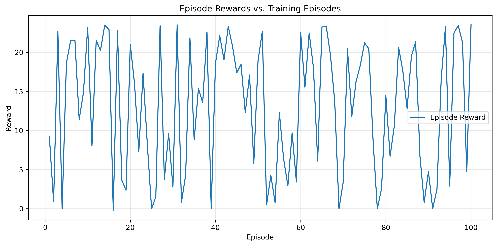
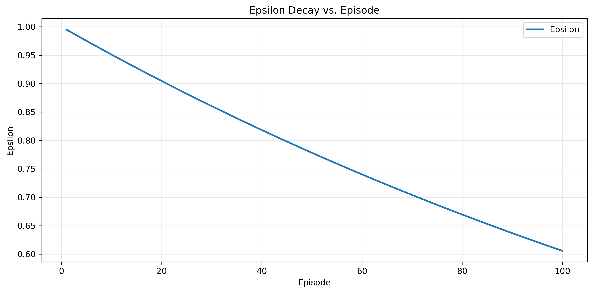

# SalesReinforcer

## Overview

**SalesReinforcer** is a Python-based reinforcement learning project that explores how an intelligent agent can learn decision-making strategies through interaction with an environment.

The project implements a **Q-learning agent** that learns from rewards and adjusts its action-selection strategy over multiple training episodes. It uses an epsilon-greedy policy to balance exploration and exploitation, while updating a Q-table to improve its decisions over time.

The goal is to develop a reinforcement learning framework that can learn effective strategies in a sales-related decision environment.

## Key Features

- **Q-Learning:** Implements the temporal-difference Q-learning algorithm to learn state-action values.
- **Epsilon-Greedy Policy:** Balances exploration of new actions with exploitation of previously learned strategies.
- **Adaptive Exploration:** Gradually reduces epsilon during training using an epsilon decay schedule.
- **Q-Table Management:** Stores learned action values for individual environment states.
- **Reward Tracking:** Records cumulative rewards across training episodes.
- **Best-State Tracking:** Identifies and retains the state associated with the highest observed environment reward.
- **Training Monitoring:** Logs episode progress, rewards, and exploration rates.

## Reinforcement Learning Approach

The agent follows the Q-learning update equation:
```math
Q(s,a) \leftarrow Q(s,a) + \alpha
[r + \gamma \max_{a'} Q(s',a') - Q(s,a)]
```

$$
Where:

- \(s\): Current state
- \(a\): Selected action
- \(r\): Reward received
- \(s'\): Next state
- \(\alpha\): Learning rate
- \(\gamma\): Discount factor

### Exploration vs. Exploitation

The agent uses an epsilon-greedy strategy:

- With probability epsilon, it selects a random action.
- Otherwise, it selects an action with the highest estimated Q-value.

Epsilon decreases after each completed episode, gradually shifting the agent from exploration toward exploitation.

## Model Configuration

The Q-learning agent supports configurable hyperparameters:

| Parameter | Default | Description |
|---|---:|---|
| Learning rate | 0.1 | Controls the magnitude of Q-value updates |
| Discount factor | 0.95 | Determines the importance of future rewards |
| Initial epsilon | 1.0 | Initial exploration probability |
| Epsilon decay | 0.995 | Exploration reduction rate |
| Minimum epsilon | 0.01 | Minimum exploration probability |
| Random state | 42 | Supports reproducible random behavior |

## Training and Evaluation

The training process consists of the following steps:

1. Initialize the environment and reset the starting state.
2. Select an action using the epsilon-greedy policy.
3. Execute the action and observe the next state and reward.
4. Update the Q-table using the Q-learning update equation.
5. Repeat until the episode terminates.
6. Record the episode reward and evaluate the final environment state.
7. Decay epsilon and continue with the next episode.

The training routine returns:

- `best_state`: Best-performing state identified during training.
- `best_reward`: Highest observed environment reward.
- `episode_rewards`: Reward history across training episodes.
- `epsilon_history`: Epsilon values recorded throughout training.

## Technologies

- **Python** – Core implementation
- **NumPy** – Numerical computation and Q-table operations
- **Reinforcement Learning** – Sequential decision-making and reward-based learning
- **Q-Learning** – Model-free reinforcement learning algorithm
- **Git / GitHub** – Version control

## Project Structure

```text
SalesReinforcer/
│
├── src/
│   └── qlearningagent.py
│   └── data-processing.py
│   └── evaluate.py
│   └── rl_environment.py
│   └── feature_selection.py
│   └── reward_function.py
│   └── main.ipynb
├── README.md
└── requirements.txt
```

*The structure above highlights the source file inspected; additional repository components can be documented as they are verified.*

## Getting Started

### 1. Clone the repository

```bash
git clone https://github.com/bqsauce-ux/SalesReinforcer.git
cd SalesReinforcer
```

### 2. Create a virtual environment

```bash
python3 -m venv venv
source venv/bin/activate
```

### 3. Install dependencies

```bash
pip install numpy
```

### 4. Integrate the Q-learning agent

The `QLearningAgent` class accepts an environment implementing the following interface:

- `reset()` – Initializes an episode and returns the starting state.
- `step(action)` – Executes an action and returns the next state, reward, termination flag, and additional information.
- `get_reward()` – Returns the environment's evaluation reward.
- `get_state()` – Returns the current environment state.

The agent can then be trained using:

```python
results = agent.train(
    environment,
    episodes=100
)
```

## Future Improvements

- Visualize cumulative rewards across training episodes.
  
- Plot epsilon decay to monitor exploration behavior.
  
- Compare different learning rates and discount factors.
- Evaluate performance across multiple training runs.
- Introduce additional reinforcement learning algorithms for comparison.
- Improve model persistence and evaluation.

## Author

**bqsauce-ux**

GitHub: https://github.com/bqsauce-ux

